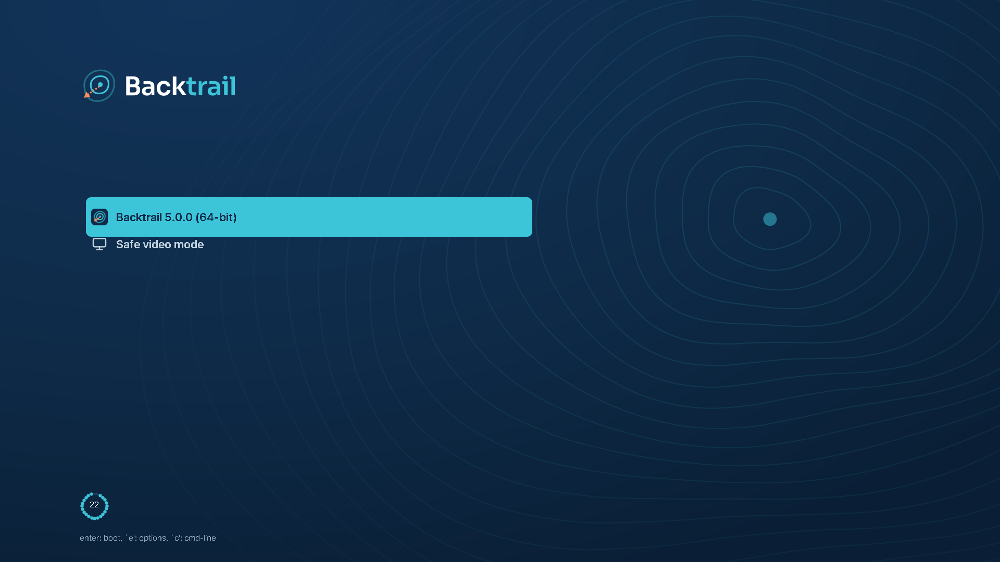
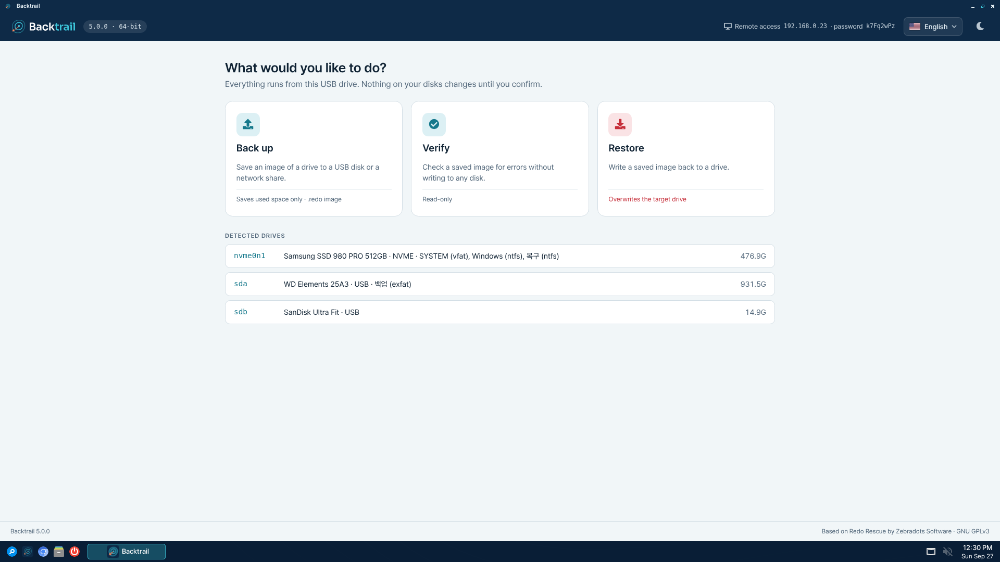
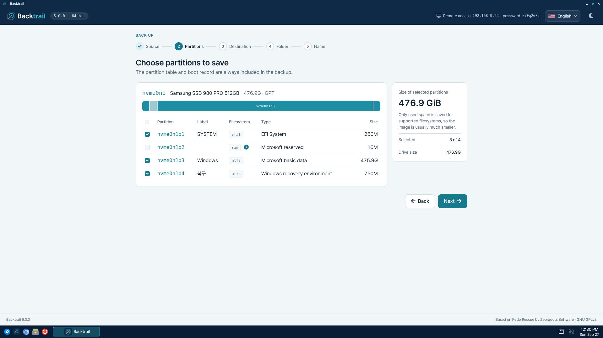
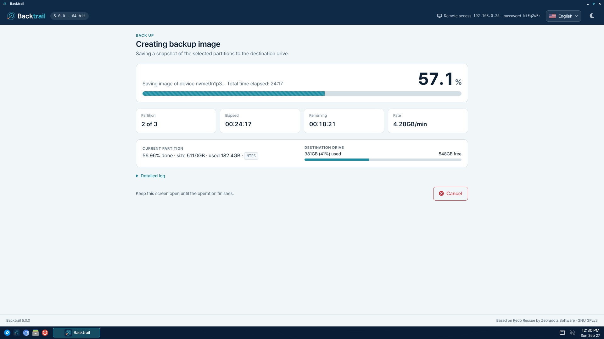
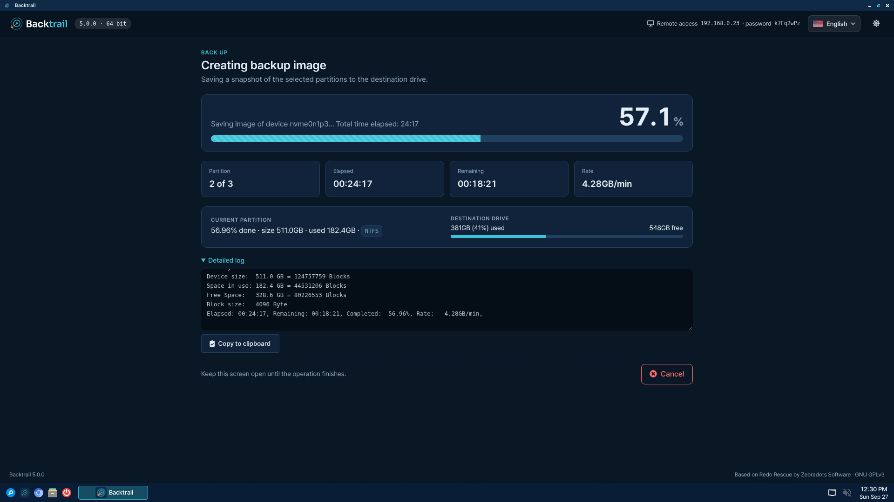
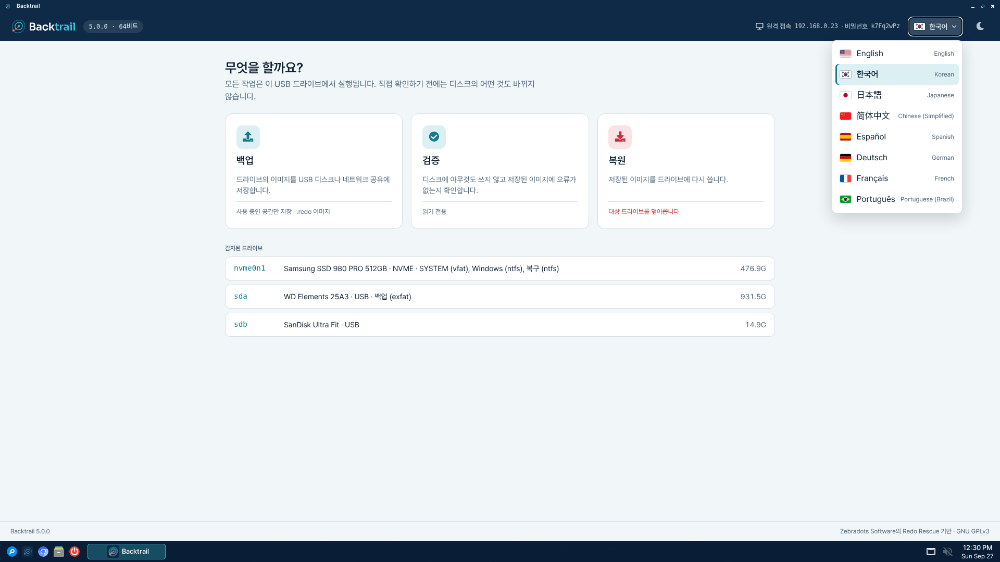

# Backtrail

[English](README.md) | **한국어**

  

## 소개

**Backtrail**은 시스템의 스냅샷을 만들고 복원하는 라이브 CD/USB 시스템입니다.
새로 산 빈 드라이브에도 이미지를 복원할 수 있어서, 랜섬웨어와 바이러스,
실수로 지운 파일, 하드웨어 고장, 해킹 피해에서 몇 분 만에 복구할 수 있습니다.

Backtrail은 독립 오픈 소스 프로젝트입니다. 첫 릴리스는 Redo Rescue의 버전
번호를 이어받은 5.0입니다.

## 내력

Backtrail은 Zebradots Software가 2010년에 만든
[Redo Rescue](https://github.com/redorescue/redorescue)(이전 이름 Redo
Backup)를 잇는 프로젝트입니다. Redo Rescue의 마지막 릴리스는 2021년의
4.0.0이고, 개발은 5.0.0을 내지 못한 채 2023년 10월에 멈췄습니다. Backtrail은
그 지점에서 Redo Rescue의 전체 커밋 이력을 이어받아 작업을 계속합니다.

  * **호환되는 이미지**: `.redo` 이미지 형식을 그대로 써서, Redo Rescue와
    Redo Backup 1.0.4로 만든 백업을 Backtrail로 복원할 수 있습니다. Backtrail이
    만든 백업은 Redo Rescue 2.0 이상이 옛 Redo Backup 1.0.x 형식이 아닌 현재
    형식으로 읽도록 버전이 매겨집니다.
  * **이어지는 버전**: Backtrail 5.0은 Redo Rescue가 끝내 내지 못한 5.0
    릴리스이며, 이후 버전도 여기서 이어집니다.
  * **같은 방식**: `sfdisk`와 `partclone` 위에 단계별로 진행하는 간단한 앱을
    얹은 라이브 시스템으로, 운영체제가 없는 상태에서도 백업과 복구를 합니다.
  * **계속 관리됨**: 보안 업데이트가 적용된 최신 Debian 기반, 32비트 PC 지원,
    번역, 그리고 그동안 발견된 문제의 수정.

Redo Rescue의 로고와 그래픽은 파생 프로젝트에 사용이 허락되지 않아서,
Backtrail은 자체 이름과 아트워크를 씁니다. Backtrail은 Zebradots Software와
제휴하거나 그 보증을 받은 프로젝트가 아닙니다. Redo Rescue에서 무엇을 왜
바꿨는지는 [HERITAGE.md](HERITAGE.md)에, 두 프로젝트의 릴리스 이력은
[CHANGES.md](CHANGES.md)에 있습니다(영문).

## 스크린샷

  
  

  
  

  
  

부팅 메뉴, 첫 화면, 파티션 선택, 백업 진행, 상세 로그(다크 모드), 언어 메뉴. 화면의 드라이브는 예시 데이터입니다.

## 기능

  * 무료 오픈 소스 소프트웨어
  * 몇 번의 클릭으로 백업 이미지 생성
  * 라이브 시스템이라 부팅되지 않는 컴퓨터에서도 동작
  * 원격 지원을 위한 VNC 접속 제공
  * 베어메탈 복구: 마스터 부트 레코드와 파티션 테이블까지 복원
  * 일부 파티션만 골라서 복원
  * 원래 파티션을 다른 위치로 바꿔서 복원 가능
  * UEFI 보안 부팅(Secure Boot) 지원
  * ISO 하나로 64비트(Debian 13)와 32비트(Debian 12) PC 모두 부팅
  * CD나 USB에 기록해서 사용
  * 오류 처리와 공간 부족 경고
  * 상세 로그를 클립보드로 복사
  * Redo Rescue와 Redo Backup 1.0.4로 만든 이미지 복원
  * PHP 백엔드의 웹 앱을 전용 창(WebKitGTK)으로 표시
  * 문서 검색이나 드라이버 다운로드용 간단한 웹 브라우저
  * 한국어, 중국어, 일본어 파티션 레이블과 파일 이름 표시
  * 라이트 모드와 다크 모드
  * 영어, 한국어, 일본어, 중국어(간체), 스페인어, 독일어, 프랑스어,
    포르투갈어(브라질) 화면
  * 시스템 도구와 진단 프로그램 포함
  * 메모를 남길 수 있는 통합 백업 파일 형식
  * 네트워크 공유 폴더 검색과 감지
  * 다양한 블록 장치 지원
  * Samba/CIFS 공유, NFS 공유, SSH 파일 시스템 읽기·쓰기
  * VMware 가상 머신에서는 화면 크기 맞춤, 마우스 동기화, 클립보드 공유

## 다운로드

[Releases](https://github.com/johnhsb/backtrail/releases/latest) 페이지에서
최신 ISO(`backtrail-VERSION.iso`)와 `SHA256SUMS`를 받으세요. 받은 파일이
온전한지 다음 명령으로 확인할 수 있습니다.

    sha256sum -c SHA256SUMS --ignore-missing

5.0.1부터는 ISO가 이 저장소의 릴리스 워크플로로 빌드됐는지도
[GitHub CLI](https://cli.github.com/)로 확인할 수 있습니다.

    gh attestation verify backtrail-5.0.1.iso --repo johnhsb/backtrail

ISO는 CD에 굽거나 USB 메모리에 기록해서 씁니다. USB에 기록할 때는
[balenaEtcher](https://etcher.balena.io/)나
[Rufus](https://rufus.ie/)(Windows)처럼 이미지를 그대로 쓰는 도구를 쓰고,
Linux에서는 다음처럼 기록할 수 있습니다(`/dev/sdX`는 USB 메모리 장치이며,
그 안의 내용은 모두 지워집니다).

    sudo dd if=backtrail-5.0.0.iso of=/dev/sdX bs=4M status=progress conv=fsync

## 사용 예

Backtrail은 장애 복구, 시스템 복제, 이전 상태로 되돌리기 등 다양하게 쓸 수
있습니다.

* 가족의 컴퓨터에 Windows를 설치하고 정품 인증, 드라이버 설정, 오피스 설치까지
  마쳤습니다. 시간이 많이 드는 일이라 다시 하고 싶지 않습니다. 하드 드라이브가
  고장 날 때를 대비해 Backtrail로 USB 메모리에 백업 이미지를 저장해 둡니다.

* 교실에 같은 Linux 기반 운영체제를 쓰는 컴퓨터가 수십 대 있습니다. 잘 동작하는
  시스템의 스냅샷을 Backtrail로 만들어 두면, 학생의 시스템이 망가져도 몇 분 만에
  정상 상태로 되돌릴 수 있습니다.

* 회사 노트북에 설정이 까다로운 소프트웨어가 많이 깔려 있고, 사용자가 악성 링크를
  누를 위험도 큽니다. Backtrail로 기존 파티션 크기를 줄여 같은 드라이브에 백업용
  파티션을 만들고, 그곳에 백업 이미지를 저장합니다.

* 사무실 서버를 새 하드웨어로 바꿔야 하는데, 교체 준비 동안 기존 서버는 계속
  돌아가야 합니다. Backtrail로 이미지를 만들어 새 하드웨어에 복원한 뒤 최소한의
  중단으로 전환하고, 문제가 생길 때를 대비해 기존 서버는 그대로 둡니다.

## 주의

**Backtrail은 백업 이미지를 원래 백업한 그 시스템에 복원하도록 만들어졌습니다.**
어떤 백업 소프트웨어를 쓰든, Windows 드라이브를 거의 같은 다른 컴퓨터에 바이트
단위로 그대로 복제해도 부팅되지 않을 수 있습니다. 하드웨어 부품 교체, 디스크
추가·제거·교체, 큰 설정 변경, 다른 컴퓨터로의 복원은 Windows, Mac, Linux 모두
부팅 문제를 일으키기 쉽습니다. 마찬가지로 파티션의 순서를 바꾸거나, 옮기거나,
크기를 바꾸면 대부분의 운영체제가 부팅되지 않습니다. 이런 변경 뒤에는 백업 전체가
제대로 복원되고 모든 파일이 드라이브에 안전하게 있어도 운영체제가 부팅되지 않을
수 있습니다. _이는 백업 프로그램의 한계가 아니라 시스템 구성이 바뀐 결과입니다.
시스템을 바꾼 뒤에는 새 백업 이미지를 만들어 두기를 강력히 권합니다._

Backtrail은 파티션 테이블의 백업과 복원에
[sfdisk](https://manpages.debian.org/util-linux/sfdisk.8.en.html)를, 각
파티션의 데이터 백업과 복원에
[partclone](https://manpages.debian.org/partclone/partclone.8.en.html)을
씁니다. 둘 다 매우 안정적인 도구로 알려져 있지만, 알려지지 않은 버그가 있을 수
있습니다.

## 참고

* 시스템은 기본적으로 `root` 사용자로 자동 로그인하며, 비밀번호는 `redo`입니다.
* 백업 앱은 이 컴퓨터 안에서만(`127.0.0.1`) 열립니다.
* 원격 지원이 필요하면 앱 상단의 "원격 지원 허용"을 누르고, 그때 표시되는
  주소와 비밀번호를 도와줄 사람에게 알려 주세요(VNC). SSH로 받으려면
  `/root/enable-ssh`를 실행하세요. 새 root 비밀번호를 만들어 보여 줍니다.
* 보안 모델은 [SECURITY.md](SECURITY.md)(영문)를 참고하세요.

## 빌드

Debian Linux에서 ISO 이미지를 만드는 방법입니다.

  1. `git clone https://github.com/johnhsb/backtrail.git`
  2. `cd backtrail`
  3. `sudo ./make`

결과물은 `backtrail-VERSION.iso`입니다(예: `backtrail-5.0.0.iso`).

인터넷에 연결된 Debian이나 Ubuntu 컴퓨터가 필요합니다. `./make`는 먼저 필요한
도구(`debootstrap`, `squashfs-tools`, `xorriso`, `mtools`, `dosfstools`,
`rsync`, `perl`, GRUB과 보안 부팅 파일)가 있는지 확인하고, 없는 것은
`apt-get`으로 설치하므로 미리 설치할 것은 없습니다.

ISO에는 64비트(Debian 13)와 32비트(Debian 12) 라이브 시스템이 함께 들어 있고,
부팅 메뉴가 CPU에 맞는 쪽을 고릅니다. 빌드 대상은 `make` 스크립트의 `TARGETS`로
정합니다.

빌드한 뒤에는 모든 패키지를 다시 받고 처음부터 빌드하지 않아도 파일을 고치거나
패키지를 설치할 수 있습니다.

  1. `sudo ./make changes` (한 시스템만 바꾸려면 `sudo ./make changes amd64` 또는 `i386`)
  1. 라이브 시스템 이미지 안에서 원하는 변경을 합니다
  1. `exit`하면 ISO가 자동으로 갱신됩니다

받은 패키지는 `cache/`(시스템별 폴더)에 남아서, 다음 빌드에서는 바뀐 패키지만
받습니다. 빌드 파일을 모두 지우려면 `sudo ./make clean`을 실행하세요(기본 시스템
압축 파일과 `cache/`는 남습니다). 공간을 비우려면 `cache/`를 지우면 됩니다.

로고, 부팅 메뉴, 스플래시 화면, 배경 이미지는 `branding/src`에서 생성합니다.
[branding/README.md](branding/README.md)(영문)를 참고하세요.

GitHub로 옮기기 전 Redo Rescue 릴리스의 소스 코드는
[SourceForge](https://sourceforge.net/projects/redobackup/files/src/)에
있습니다.

기여 방법은 [CONTRIBUTING.md](CONTRIBUTING.md)(영문)를 참고하세요.

## 라이선스

**Backtrail**은 바탕이 된 Redo Rescue와 같이 GNU GPLv3로 배포됩니다.

  * Copyright (C) 2026 The Backtrail Authors
  * Copyright (C) 2010-2023 Zebradots Software (Redo Rescue)

Redo Rescue 고유의 로고와 그래픽은 GNU GPLv3로 배포되지 않으며, 파생 프로젝트는
자체 그래픽을 써야 합니다. Backtrail은 이를 모두 `branding/`의 자체 아트워크로
바꿨습니다. Noto Sans CJK와 Sora 글꼴은 SIL Open Font License 1.1을 따릅니다.
부팅 메뉴에는 Noto Sans CJK의 일부 글자를 "Backtrail Sans"라는 이름으로 넣어
씁니다.

### 소스 코드

ISO는 이 저장소와 Debian 패키지로 만들어집니다. 각 라이브 시스템의 패키지 목록이
ISO 안의 `/live-amd64/filesystem.packages`와 `/live-i386/filesystem.packages`에
있고, 각 릴리스에도 같은 목록이 첨부됩니다. 목록에 있는 각 패키지 버전의 소스는
[Debian](https://snapshot.debian.org/)에서 받을 수 있습니다. 거기서 구할 수 없다면
[이슈](https://github.com/johnhsb/backtrail/issues)로 요청하면 제공해 드립니다.
